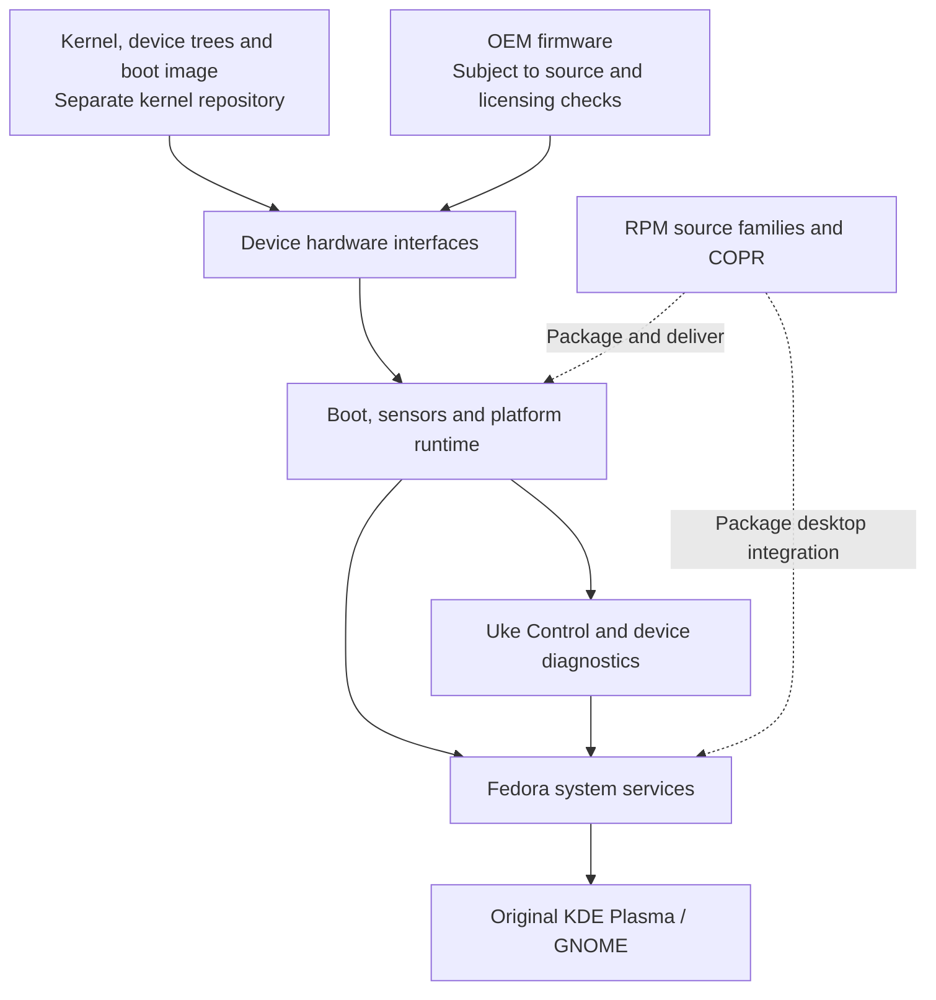

# Uke Linux Hardware Support

Device integration, platform services and Fedora packages for **Xiaomi Pad 7** and **POCO Pad X1** (`uke`, Qualcomm SM7675).

This repository brings together the userspace components needed to run Fedora on Uke hardware. It contains native utilities, system services, RPM specifications, desktop integration, firmware source records and the tests used to validate them.

[Main project](https://github.com/MCC45TR/uke-linux) · [Kernel source](https://github.com/MCC45TR/senemos-uke-kernel-mainline) · [Fedora image builder](https://github.com/MCC45TR/uke-fedora-builder) · [Hardware support](https://github.com/MCC45TR/uke-linux#hardware-support) · [Development COPR](https://copr.fedorainfracloud.org/coprs/mcc45tr/uke-linux-test/)

> [!IMPORTANT]
> Uke Linux is under active development. These packages are intended for the Uke Fedora port, not for general-purpose Fedora installations. A successful source build or RPM installation does **not** mean that a hardware feature has passed device testing.

## Overview

The project separates the kernel, hardware integration and operating-system images:

- **[senemos-uke-kernel-mainline](https://github.com/MCC45TR/senemos-uke-kernel-mainline)** maintains the kernel, device trees, drivers and matched boot packages.
- **This repository** maintains the userspace services, device controls, desktop integration and supporting RPMs.
- **[uke-fedora-builder](https://github.com/MCC45TR/uke-fedora-builder)** prepares Fedora root filesystems and bootable image artifacts.
- **[uke-linux](https://github.com/MCC45TR/uke-linux)** is the main project entry point for releases, installation guidance and hardware status.

Most components were previously maintained in separate repositories. Their sources now live directly under this repository as ordinary directories. [`SOURCE-IMPORTS.json`](SOURCE-IMPORTS.json) preserves the original import commits and repository links. These directories are **not** Git submodules.

### How the components connect



The kernel provides hardware interfaces. Native services and Fedora components use those interfaces; `uke-control` provides a shared command-line backend for supported settings. Desktop applications remain the original Fedora packages wherever possible.

## Repository structure

The tree below shows the **main directories and selected files**, rather than every source file or test fixture.

```text
uke-linux-hardware-support/
├── .copr/
│   └── Makefile                  # COPR source-RPM entry point
├── .github/
│   └── workflows/
│       ├── validate.yml         # Source and native checks
│       ├── rawhide.yml          # Fedora Rawhide source tracking
│       └── stable.yml           # Reviewed upstream source tracking
├── packaging/
│   └── families/
│       ├── families.json        # Source-family versions and dependencies
│       ├── RESPONSIBILITIES.md  # Ownership of each runtime function
│       ├── RAWHIDE-TRACKING.md  # Fedora source-update policy
│       ├── host/                # Family composition and tracking tools
│       ├── tests/               # Source and packaging contract tests
│       ├── uke-core/
│       ├── uke-hw/
│       ├── uke-power/
│       ├── uke-sensors/
│       ├── uke-extras/
│       ├── uke-additional/
│       ├── uke-metas/
│       ├── uke-camera/
│       └── uke-sound/
├── uke-boot/
│   ├── src/
│   │   ├── boot-guard.cpp       # Boot validation
│   │   ├── kernel-update.cpp    # Guarded kernel update logic
│   │   ├── dracut/              # Initramfs integration
│   │   ├── profiles/            # Device configuration and presets
│   │   └── units/               # Systemd services
│   ├── packaging/               # RPM specifications
│   ├── docs/                    # Boot, USB and update documentation
│   └── tests/
├── uke-platform-runtime/
│   ├── src/
│   │   ├── battery/             # Battery monitoring and charge-control logic
│   │   └── offline/             # Offline-charging interface
│   ├── packaging/               # Runtime and UPower integration
│   ├── patches/
│   ├── docs/
│   └── tests/
├── uke-sensors/
│   ├── src/                     # SSC, touch support and sensor utilities
│   ├── packaging/               # libssc, SensorProxy and service RPMs
│   ├── patches/                 # Reviewed upstream adaptations
│   ├── docs/
│   └── tests/
├── uke-control/
│   ├── src/                     # Native control and diagnostics
│   ├── shared/                  # Common interfaces
│   ├── host/                    # Packaging and COPR helpers
│   ├── packaging/
│   ├── tests/
│   ├── DISPLAY.md
│   ├── CHARGING.md
│   └── CHANNELS.md
├── uke-desktop-integration/
│   ├── src/                     # Power, device and desktop helpers
│   ├── packaging/
│   ├── patches/
│   ├── docs/
│   └── tests/
├── uke-desktop-metas/
│   ├── src/plasma-applet/       # Optional Plasma device-control widget
│   ├── packaging/               # KDE and desktop package selections
│   └── tests/
├── uke-desktop-packaging/
│   ├── packaging/               # Mesa, runtime, decoration and theme sources
│   ├── src/                     # Native runtime and Plymouth theme
│   ├── docs/
│   └── tests/
├── uke-core-meta/               # Minimal Fedora/Core package selection
├── uke-orangefox-packaging/     # Recovery-image RPM and source records
├── xiaomi-uke-firmware/         # Firmware identity, staging and licensing
├── uke-camera/                  # Camera integration plans and package scope
├── plasma-uke-kcm/              # Planned Plasma settings module
├── uke-hardware-provenance/     # Hardware/source provenance definitions
├── SOURCE-IMPORTS.json         # Historical source-import records
├── AGENTS.md                   # Development and source policies
├── Makefile                    # Root validation and native test targets
└── README.md
```

Within most components, `src/` contains maintained code, `packaging/` contains RPM rules, `tests/` contains host-side checks, `manifests/` pins inputs and `docs/` explains implementation and validation. Not every component has every directory.

## Components

The directories below describe **source ownership**, not separate installed packages. A component can contribute to more than one RPM.

| Component | Responsibility | Notes |
| --- | --- | --- |
| [`uke-boot`](uke-boot/) | Boot guards, update admission, device startup, USB diagnostics and recovery paths | Boot writes are gated; installing an RPM does not automatically flash an image. |
| [`uke-platform-runtime`](uke-platform-runtime/) | Battery telemetry, charge-control interfaces, UPower integration and offline charging | Reporting a setting is not proof of a physical charging cutoff. |
| [`uke-sensors`](uke-sensors/) | SSC transport, motion/light/proximity integration, sensor services and touch-related support | Device-specific calibration is not public package data. |
| [`uke-control`](uke-control/) | Device status, diagnostics, USB, display, battery, swap and update controls | Native backend used by optional desktop controls. |
| [`uke-desktop-integration`](uke-desktop-integration/) | Display/sensor desktop setup, power-profile integration and device helpers | Uses standard Fedora desktop interfaces. |
| [`uke-desktop-metas`](uke-desktop-metas/) | KDE and desktop package selection; optional Plasma tray widget | Does not fork KDE applications. |
| [`uke-desktop-packaging`](uke-desktop-packaging/) | Upstream package adaptations, Mesa/runtime sources, decoration and Plymouth theme | Optional components retain their upstream identities and licenses. |
| [`uke-core-meta`](uke-core-meta/) | Base Fedora console package selection | Does not install the graphical desktop by itself. |
| [`uke-orangefox-packaging`](uke-orangefox-packaging/) | Checksummed recovery-image delivery as RPM data | Installation does not flash recovery or change boot slots. |
| [`xiaomi-uke-firmware`](xiaomi-uke-firmware/) | OEM firmware inventories, source checks and local/public staging rules | Redistribution review and private per-device data remain separate. |
| [`uke-camera`](uke-camera/) | Camera graph and userspace package planning | No qualified camera capture pipeline is provided by this component. |
| [`plasma-uke-kcm`](plasma-uke-kcm/) | Planned device-specific Plasma settings module | Planning/scaffolding; not a completed settings panel. |
| [`uke-hardware-provenance`](uke-hardware-provenance/) | Sanitized hardware and source provenance records | Metadata does not establish hardware functionality. |

The separate [`packaging/families/RESPONSIBILITIES.md`](packaging/families/RESPONSIBILITIES.md) identifies which functions belong in the kernel and which need userspace services. It is the best starting point before adding another daemon or moving a feature between components.

## RPM packages and source families

**A source family is a build and publication unit, not necessarily an RPM with the same name.** For example, the `uke-hw` family brings together boot integration and related hardware packages, while `uke-metas` produces package selections.

The family definitions, versions, build inputs and dependencies are maintained in [`packaging/families/families.json`](packaging/families/families.json).

| Source family | What it builds or selects |
| --- | --- |
| `uke-core` | Uke Control and its associated native core packages. |
| `uke-hw` | Boot integration, installation/update support and hardware-related package dependencies. |
| `uke-power` | Battery, UPower, power-profile and related integrations. |
| `uke-sensors` | libssc, SensorProxy and optional sensor services. |
| `uke-extras` | Optional appearance and recovery-related packages. |
| `uke-additional` | Reviewed Fedora runtime, graphics and compatibility adaptations. |
| `uke-metas` | Console and KDE desktop selections and their integration. |
| `uke-camera` | Camera package selection only; not a functioning camera driver. |
| `uke-sound` | Standard Fedora audio userspace selection; not proof of internal audio hardware support. |

Kernel RPMs come from the [kernel repository](https://github.com/MCC45TR/senemos-uke-kernel-mainline), not from these hardware-support families. The [COPR source entry](.copr/Makefile) accepts explicitly reviewed components and packages; it does not publish every directory automatically.

Development packages: [mcc45tr/uke-linux-test](https://copr.fedorainfracloud.org/coprs/mcc45tr/uke-linux-test/). Production or broader release suitability must be assessed separately from a successful COPR build.

## Build and validation

Clone this repository on a Linux development host:

```sh
git clone https://github.com/MCC45TR/uke-linux-hardware-support.git
cd uke-linux-hardware-support
```

Run the repository checks:

```sh
make validate
make test-native
make -C packaging/families check
```

These commands require the appropriate host development tools and libraries. The [validation workflow](.github/workflows/validate.yml) runs the project checks in a Fedora Rawhide environment. They do **not** boot a tablet, install device packages or exercise physical hardware.

For a narrower change, run the owning component's tests first:

```sh
make -C uke-control check
make -C uke-sensors test-native
make -C uke-boot test-native
```

The root `Makefile` validates each maintained component and runs selected native suites. The family checker verifies package composition and build contracts. Source tests, COPR builds, RPM installation and device tests are separate validation stages.

### Packaging and release flow

```text
Reviewed source change
        |
        v
Component tests + root validation
        |
        v
Source-family dependency and RPM checks
        |
        v
COPR source RPM and native AArch64 package build
        |
        v
Signed package verification and DNF transaction
        |
        v
Matched device installation, reboot and physical tests
        |
        v
Recorded acceptance for that exact build and device
```

GitHub Actions provides three entry points:

| Workflow | Purpose |
| --- | --- |
| [`validate.yml`](.github/workflows/validate.yml) | Validate changes and request eligible family builds after the required checks. |
| [`rawhide.yml`](.github/workflows/rawhide.yml) | Track selected Fedora Rawhide sources and dispatch validation when source locks change. |
| [`stable.yml`](.github/workflows/stable.yml) | Track reviewed upstream releases for eligible optional packages. |

A green GitHub Actions run means the checks in that workflow passed. It does **not** qualify charging protection, battery safety, suspend/resume, cameras or any other physical feature.

## Where to make changes

If you are working on a particular subsystem, start here:

| Task | Main source or guide |
| --- | --- |
| Kernel driver, device tree or EL2/KVM | [Senemos Uke kernel](https://github.com/MCC45TR/senemos-uke-kernel-mainline) |
| Kernel update, matched boot image or rollback | [`uke-boot/`](uke-boot/) · [Update guide](uke-boot/docs/KERNEL-UPDATES.md) |
| USB-C role, gadget, CDC logging or dock integration | [`uke-boot/`](uke-boot/) · [Type-C guide](uke-boot/docs/USB-TYPEC.md) · [`uke-control/`](uke-control/) |
| Battery readings, charge management or offline charging | [`uke-platform-runtime/`](uke-platform-runtime/) · [Charging policy](uke-platform-runtime/docs/CHARGE-CONTROL.md) |
| Touch, motion, ambient light or proximity services | [`uke-sensors/`](uke-sensors/) · [SSC desktop guide](uke-sensors/docs/SSC-DESKTOP.md) · [Touch migration](uke-boot/docs/TOUCH-RUNTIME.md) |
| Device command-line controls or diagnostic reports | [`uke-control/`](uke-control/) · [Diagnostics](uke-control/DIAGNOSTIC.md) |
| Plasma device controls or desktop application selection | [`uke-desktop-metas/`](uke-desktop-metas/) · [`plasma-uke-kcm/`](plasma-uke-kcm/) |
| Graphics/runtime RPMs, Mesa adaptations or themes | [`uke-desktop-packaging/`](uke-desktop-packaging/) |
| Camera capture pipeline | [`uke-camera/`](uke-camera/) and the kernel's media drivers |
| Firmware provenance, local staging or redistribution scope | [`xiaomi-uke-firmware/`](xiaomi-uke-firmware/) · [Firmware publication review](xiaomi-uke-firmware/docs/COPR-PUBLICATION.md) |
| Source-family versions, dependencies and COPR builds | [`packaging/families/`](packaging/families/) · [Families policy](packaging/families/README.md) |

For desktop features, prefer existing Fedora and KDE interfaces. A device control should appear in the UI only when the corresponding kernel/userspace capability is available and validated. The optional Plasma applet delegates hardware actions to the native `uke-control` backend.

## On-device diagnostics

On an **already configured Uke Fedora installation** with Uke Control installed, these are useful starting points:

```sh
uke-control status
uke-control inventory
uke-control usb status
uke-control sensors -n5
```

The available commands depend on the installed Uke Control version and kernel. See the [Control README](uke-control/README.md) for the full command list, permissions and test limits. Administrative actions involving USB roles, charging, swap or boot updates should not be used as routine health checks.

For the current hardware matrix, use the [main project's hardware table](https://github.com/MCC45TR/uke-linux#hardware-support). A component's source or README may describe an older build; do not treat its historical test notes as the status of the latest image.

## Firmware, updates and safety

- **Keep kernel and userspace matched.** Kernel Image, modules, DTBs and boot profile must belong to the same reviewed build. A DNF transaction alone does not prove that the new boot image is active.
- **Protect recovery paths.** Automatic boot writes are disabled by default in the documented updater. Review the [kernel-update requirements](uke-boot/docs/KERNEL-UPDATES.md) and retain a verified rollback before any explicit update trial.
- **Keep device data private.** Factory identifiers, touch references and calibration do not belong in public source archives or generic images. The firmware component records acquisition and licensing boundaries; hash verification is not a redistribution license.
- **Preserve original system components.** KDE/GNOME applications are obtained from Fedora. Native project tools use C++ and shell; original Fedora desktop packages may retain their upstream dependencies. Project-owned tablet services and initramfs payloads do not ship Python.
- **Do not infer hardware safety from software checks.** Charge limits, electrical cutoff, USB protection, thermal behavior, camera output and sleep need physical qualification on the exact device and software combination.

The repository's hardware and integration baseline was last summarized in the previous README on **26 October 2026**. Source-family tracking changed on **28 October 2026**. Use per-component records and the main project's hardware table for later, device-specific results; these changes alone do not establish new hardware acceptance.

## Documentation

| Topic | Reference |
| --- | --- |
| Component ownership | [Runtime responsibilities](packaging/families/RESPONSIBILITIES.md) |
| Fedora source and package updates | [Rawhide tracking](packaging/families/RAWHIDE-TRACKING.md) |
| Boot layout and kernel updates | [Kernel updates](uke-boot/docs/KERNEL-UPDATES.md) · [Userdata A/B experiments](uke-boot/docs/USERDATA-AB.md) |
| USB Type-C | [USB and dock policy](uke-boot/docs/USB-TYPEC.md) |
| Battery and charging | [Battery observations](uke-platform-runtime/docs/BATTERY.md) · [Charge control](uke-platform-runtime/docs/CHARGE-CONTROL.md) |
| Sensors and touch | [SSC desktop](uke-sensors/docs/SSC-DESKTOP.md) · [Front color](uke-sensors/docs/FRONT-COLOR.md) · [Kernel touch capture](uke-sensors/docs/KERNEL-TOUCH-CAPTURE.md) |
| Device controls | [Control README](uke-control/README.md) · [Display](uke-control/DISPLAY.md) · [Channels](uke-control/CHANNELS.md) |
| Recovery packaging | [OrangeFox delivery](uke-orangefox-packaging/docs/DELIVERY.md) |
| Firmware sources | [OEM inputs](xiaomi-uke-firmware/docs/OEM-RUNTIME-INPUTS.md) |
| Original source imports | [`SOURCE-IMPORTS.json`](SOURCE-IMPORTS.json) |
| Development rules | [`AGENTS.md`](AGENTS.md) |

## Contributing

Keep changes in the component that owns the feature. Include the device model, kernel and package versions, the tests you ran and any known limits when reporting a problem or submitting a patch. Do not include serial numbers, factory addresses, calibration files or private logs.

Use [GitHub Issues](https://github.com/MCC45TR/uke-linux-hardware-support/issues) for reproducible integration or packaging problems. Kernel issues belong in the [kernel repository](https://github.com/MCC45TR/senemos-uke-kernel-mainline), while image installation issues should be reported through the [main Uke Linux project](https://github.com/MCC45TR/uke-linux).

## License

Project-owned code and documentation are covered by the [MIT License](LICENSE) unless noted otherwise. Imported and upstream components retain their own licenses and source attribution. OEM firmware has separate distribution terms.

Uke Linux is an independent community project and is not affiliated with Xiaomi, POCO, Qualcomm or Fedora.
