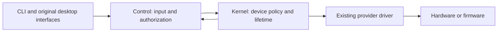

# Control and kernel ownership

30 October 2026. Source candidate 2.4.0. This document describes the source
contract; it does not establish a new installed kernel or physical acceptance.

Control presents status, validates user input and transports authorized requests.
Hardware drivers retain resource ownership, bounds, ordering, suspend handling
and cleanup. Firmware-owned hardware remains under its reviewed firmware API.

| Function | Owner and Control's remaining role |
|---|---|
| RGB warnings, test duration and animation | Existing `uke-rgb` kernel consumer; Control transports ioctls and reports status. |
| Torch steps, remembered request, exclusive writer and off on close/sleep/shutdown | New `uke-torch` kernel consumer; Control transports unchanged percentages and enable requests. The original QCOM flash provider retains current programming. |
| Charging thresholds, voltage, limits and autonomous expiry | Firmware and qualified kernel transport. Control queries the separate charging service and preserves qualification refusals. A userspace timer cannot qualify temporary-full expiry. |
| USB/Type-C, DP training and compression | Existing kernel owners perform negotiation and sequencing. Control requests advertised policies, waits for completion and reports requested versus active state. Readback alone does not prove a physical link. |
| Runtime PM, wake capability and device removal | Owning kernel drivers. Control may persist an explicit preference and replay it through the supported kernel interface. Missing capabilities remain unavailable. |
| Display mode, rotation, brightness and session policy | Original Fedora KScreen/KWin, GNOME and power-management interfaces; Control is a client. Desktop session choices remain in userspace. |
| Active-session authorization | D-Bus, Polkit, DAC, SELinux and service device restrictions. These remain in userspace. |
| Saved preferences, RPM/DNF, boot selection, swap and offline layout maintenance | Userspace services and existing guarded tools. Filesystem administration and package transactions are not kernel device policies. |
| Diagnostics and presentation | Bounded read-only userspace collectors; kernel status and errors remain distinct from physical acceptance. |

## Torch contract

`/dev/uke-torch` ABI 1 has fixed-width status, percentage and enable requests.
The kernel validates the existing board, provider, DT channels, torch-only mode,
20,000 microampere ceiling and two real current steps before publishing it.
There is one writer; independent read-only status descriptors do not acquire
control. Closing the last reference to the writer requests off, including after
SIGKILL. A reader closing cannot turn off another writer's request.

Percentages are transported unchanged. The kernel maps 1–99 to the existing
10 mA total step and 100 to 20 mA total. Zero/disable requests off without
forgetting the last positive successful request. A fresh writer starts off with
100 as its remembered request. No deadline or persistent-on policy is added.

System sleep requests off and refuses new on requests during preparation.
A failed off returns an error to the PM notifier chain; resume and aborted sleep
do not automatically relight the torch. Removal/shutdown mark the interface dead
before releasing the supplier. Late descriptors retain state memory and return
`ENODEV`, without accessing a released LED provider. Failed writes attempt off;
status preserves the original error and reports unknown brightness if the
fallback also fails. These are driver call results, not electrical measurements.

The broker has access to its character device, with read-only sysfs. The old
sysfs permission helper, advisory lock, brightness mapping and destructor writes
are removed. During RPM upgrade, `%pre` stops the old service and runs the old
installed helper's removal path before replacing the old SELinux module. New
installations create no sysfs write grant. An older kernel without this ABI
leaves flashlight control unavailable; there is no sysfs fallback. RGB remains
independent of the torch supplier and broker.

Native validation must run the actual-function lifecycle fixture, supplier
checks, complete Control checks, compiled SELinux checks and a target kernel
object build in COPR. Separate attended hardware validation must cover visible
output, kill/close, suspend and supplier removal with recoverable rollback.
